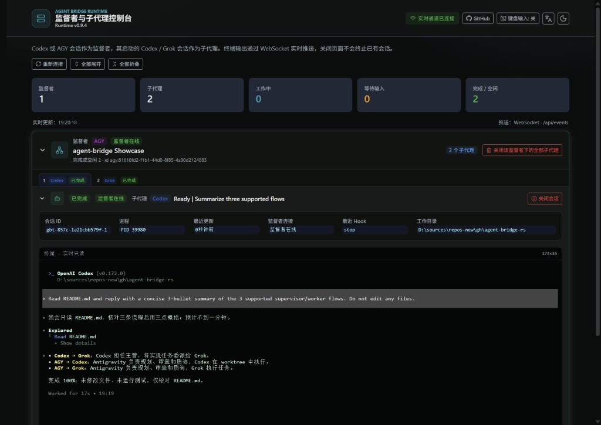
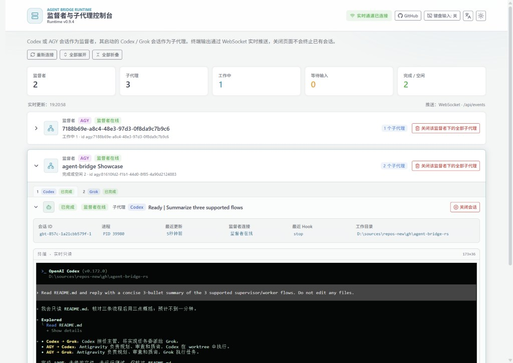

# agent-bridge 本地 Runtime（支持 Antigravity 与 Codex）

<p>
  <a href="https://github.com/luodaoyi/agent-bridge-rs/actions/workflows/ci.yml?query=branch%3Amain"></a>
  <a href="https://github.com/luodaoyi/agent-bridge-rs/actions/workflows/release.yml"></a>
  <a href="https://github.com/luodaoyi/agent-bridge-rs/releases/latest"></a>
  <a href="https://github.com/luodaoyi/agent-bridge-rs/releases"></a>
  <a href="https://github.com/luodaoyi/agent-bridge-rs/stargazers"></a>
  <a href="https://github.com/luodaoyi/agent-bridge-rs/issues"></a>
  <a href="https://github.com/luodaoyi/agent-bridge-rs/blob/main/LICENSE"></a>
</p>

[English](README.md) | [简体中文](README-CN.md)

`agent-bridge` 是一个轻量级本地单例 PTY 运行时，服务 **2×2 有界宿主/执行器调度矩阵**：

- **Codex → Grok**：Codex 负责规划与终验，Grok 执行具体实现。
- **AGY → Codex**：Antigravity 负责路线规划与验收门禁，Codex 在指定 Worktree 编写代码与自测，AGY 独立审查 Diff / 跑测试并发起对抗式挑战打回。
- **AGY → Grok**：Antigravity 负责规划与挑战，Grok 执行实现任务。

运行时与旧版 `grok-bridge` 完全隔离（独立 IPC 标识 `agent-bridge-runtime-v1-*`、默认回环 WebUI `127.0.0.1:47654`、独立环境变量前缀 `AGENT_BRIDGE_*`）。

## WebUI 界面预览

内置基于 Tabler 与 xterm.js 的控制台（`http://127.0.0.1:47654`），通过本地同源 WebSocket（`ws://127.0.0.1:47654/api/events`）实时推送生命周期与终端输出流：

- **双宿主分组与标签页切换**：按在线监督者会话（`AGY` / `Codex`）归组展示持久化的子代理（`Codex` / `Grok`），多子代理通过 Tab 快速切换并支持整组或单会话一键关闭。
- **实时终端与安全接管**：默认以只读实时模式通过 xterm.js 还原彩色 ANSI 输出，点击顶栏**键盘输入**开关即可进入交互式接管并调节终端高度；关闭网页不会终止后台运行中的 Worker。
- **Hook 与元信息遥测**：卡片直接呈现会话 ID、进程 PID、工作目录、监督者在线租约状态及最新 Hook 事件（`session_start`、`user_prompt_submit`、`pre_tool_use`、`post_tool_use`、`stop` 等）。
- **主题与 15 种语言**：支持自动 / 浅色 / 深色主题与 15 种语言界面（含阿拉伯语 RTL 布局）。

### 深色主题（简体中文）



### 浅色主题（简体中文）



## 核心特性

- **单机轻量本地 PTY 运行时（Windows / macOS / Linux）**：无需外部数据库或云端中继，单守护进程托管全部 Subagent（Windows 启用 ConPTY + Job Object 进程树隔离、`WinSta0\Default` 桌面归位及 `codex --no-daemon` 防护）。
- **原生桌面接管终端**：运行 `agent-bridge terminal --session <id>` 可打开基于 `eframe`/`egui` 的原生接管窗口（支持 `Consolas` + 中文字体回退），关闭窗口仅分离显示而保留后台会话。
- **交互式配置 TUI**：在终端中无参数直接运行 `agent-bridge`，进入图形化字符菜单完成安装、体检与服务端启停管理。
- **双宿主无损部署与 Hook 合并**：`agent-bridge install` 自动部署 Codex Skill 与 Antigravity 原生插件，并**无损合并**进 `~/.codex/hooks.json`（保留用户已有第三方 Hook，如 `rtk hook codex`）。
- **双通道高可靠 Hook 投递**：`agent-bridge __hook` 优先走本地 IPC，并在隔离环境自动回退至带本地随机会话 Token 校验的回环 HTTP 接口（`POST /api/hooks`，校验 `X-Agent-Bridge-Hook-Token`），支持非 `SessionStart` 事件基于规范化 `cwd` 完成延迟会话绑定。
- **宿主租约与孤儿宽限清理**：内置宿主心跳租约（默认 `120s`）与孤儿宽限期（默认 `600s`），支持通过 `close-client` 一键清理当前宿主对话派生的全部子进程。

## 快速开始

### 1. 环境准备

确认本机已安装并登录目标执行器 CLI（`codex` 和/或 `grok`）：

```bash
codex --version
grok --version
```

### 2. 安装与双宿主部署

通过 `pnpm` 或 `npm` 全局安装（或从源码编译），然后运行 `install` 与 `doctor`：

```bash
pnpm add -g agent-bridge-rs@latest
# 或使用 npm：
# npm install -g @asural/agent-bridge@latest
# 或源码构建：
# cargo build --release

agent-bridge install
agent-bridge doctor --worker all
```

`agent-bridge install` 会自动部署：
- **Codex Skill**：`~/.agents/skills/agent-bridge/`（`SKILL.md`、`agents/openai.yaml`、原生二进制）
- **Antigravity (AGY) 原生插件**：`~/.gemini/config/plugins/agent-bridge/`（`plugin.json`、`skills/codex-worker/SKILL.md`、`skills/grok-worker/SKILL.md`、原生二进制）
- **Lifecycle Hooks**：
  - Grok Hooks → `~/.grok/hooks/agent-bridge.json`（若检测到旧版 `grok-bridge.json` 会提示手动删除，不会擅自删除）
  - Codex Hooks → 无损合并进 `~/.codex/hooks.json`（保留已有的 `rtk hook codex` 等第三方 Hook）

### 3. 常用命令

`create` 和创建态 `terminal` 必须显式指定 `--worker grok|codex`：

```bash
# AGY 调度 Codex（--always-approve 默认映射为 -s workspace-write -a never）
agent-bridge create --worker codex --cwd /path/to/worktree --owner "任务标题" --prompt "Objective: ..." --always-approve

# AGY / Codex 调度 Grok
agent-bridge create --worker grok --cwd /path/to/repo --owner "任务标题" --prompt "Objective: ..." --always-approve

# 等待空闲、读取输出、对抗式挑战打回、清理
agent-bridge wait --session <id> --for tui-idle --timeout-ms 300000
agent-bridge read --session <id> --cursor 0 --limit 4096 --wait-ms 5000
agent-bridge send --session <id> --text "Challenge round 1: ..."
agent-bridge close --session <id>
agent-bridge close-client   # 一键关闭当前宿主对话（CODEX_THREAD_ID / ANTIGRAVITY_CONVERSATION_ID）派生的全部子进程

# WebUI 看板与原生接管终端
agent-bridge server ui     # http://127.0.0.1:47654
agent-bridge terminal --session <id>
agent-bridge doctor --worker all
```

## 主要环境变量

| 变量 | 说明 |
| --- | --- |
| `CODEX_BIN` / `GROK_BIN` | 覆盖默认执行器可执行文件路径 |
| `AGENT_BRIDGE_WEB_ADDR` | WebUI 与 Hook 回环监听地址（默认 `127.0.0.1:47654`） |
| `AGENT_BRIDGE_ALLOWED_ROOTS` | 限制允许的 `--cwd` 根目录列表 |
| `AGENT_BRIDGE_CLIENT_LEASE_SECONDS` | 宿主租约超时秒数（默认 `120`） |
| `AGENT_BRIDGE_ORPHAN_GRACE_SECONDS` | 空闲孤儿宽限期秒数（默认 `600`） |
| `AGENT_BRIDGE_CJK_FONT` / `AGENT_BRIDGE_CJK_FONT_INDEX` | 覆盖 `egui` 中文字体回退路径 |
| `AGENT_BRIDGE_DISABLE_UPDATE_CHECK` | 禁用 GitHub Release 更新检查 |

## 相关文档

- [AGENTS.md](AGENTS.md) — 仓库唯一权威 AI Agent 与贡献者入口
- [docs/subsystems/README.md](docs/subsystems/README.md) — 子系统参考卡总索引
- [CHANGELOG.md](CHANGELOG.md) — 版本变更记录
- [SECURITY.md](SECURITY.md) — 安全边界与漏洞反馈说明
