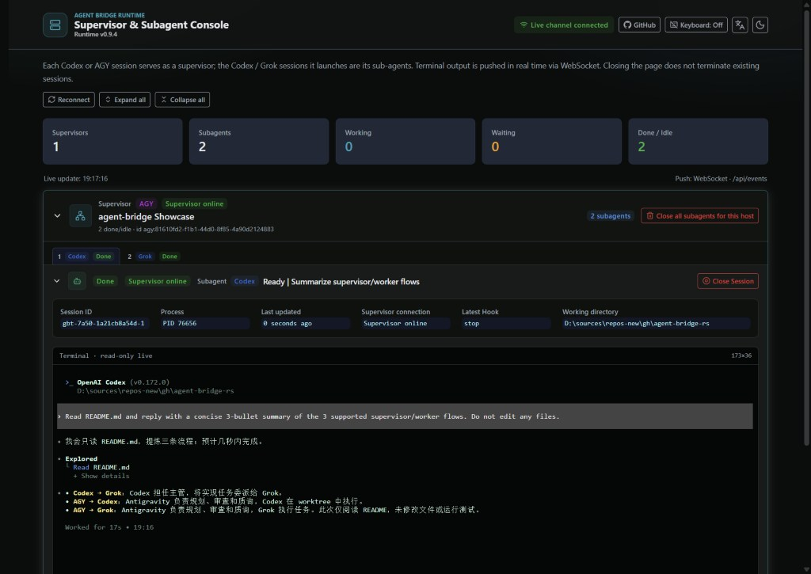
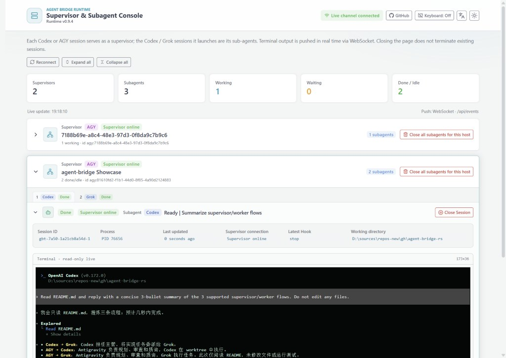

# agent-bridge Local Runtime (Codex & Antigravity)

<p>
  <a href="https://github.com/luodaoyi/agent-bridge-rs/actions/workflows/ci.yml?query=branch%3Amain"></a>
  <a href="https://github.com/luodaoyi/agent-bridge-rs/actions/workflows/release.yml"></a>
  <a href="https://github.com/luodaoyi/agent-bridge-rs/releases/latest"></a>
  <a href="https://github.com/luodaoyi/agent-bridge-rs/releases"></a>
  <a href="https://github.com/luodaoyi/agent-bridge-rs/stargazers"></a>
  <a href="https://github.com/luodaoyi/agent-bridge-rs/issues"></a>
  <a href="https://github.com/luodaoyi/agent-bridge-rs/blob/main/LICENSE"></a>
</p>

[English](README.md) | [简体中文](README-CN.md)

`agent-bridge` is a local, single-runtime PTY bridge supporting a bounded **2×2 supervisor/worker matrix**:

- **Codex → Grok**: `codex` plans and reviews while delegating implementation tasks to `grok`.
- **AGY → Codex**: `Antigravity` plans, verifies diffs/tests, and runs adversarial challenges while `codex` edits and tests inside an isolated worktree.
- **AGY → Grok**: `Antigravity` plans and challenges while `grok` executes implementation work.

It is completely isolated from legacy `grok-bridge` (`agent-bridge-runtime-v1-*` named-pipe/Unix-socket IPC, `127.0.0.1:47654` loopback WebUI, and `AGENT_BRIDGE_*` environment variables).

## WebUI Preview

The embedded Tabler + xterm.js WebUI (`http://127.0.0.1:47654`) streams live terminal output and session state over WebSocket (`ws://127.0.0.1:47654/api/events`):

- **Hierarchical ownership & tabs**: groups persistent worker processes (`Codex` / `Grok`) under each online supervisor conversation (`AGY` / `Codex`) with compact per-supervisor tabs.
- **Live terminal & safe takeover**: renders color ANSI output via xterm.js in read-only mode by default, with a top-bar **Keyboard** toggle for interactive input takeover and adjustable terminal height.
- **Hook & metadata telemetry**: displays session ID, worker PID, working directory, supervisor lease state, latest lifecycle hook (`session_start`, `user_prompt_submit`, `pre_tool_use`, `post_tool_use`, `stop`), and one-click session/group cleanup.
- **Themes & 15 locales**: supports Auto / Light / Dark color modes and 15 languages (`en`, `zh-CN`, `zh-TW`, `ja`, `ko`, `ru`, `es`, `fr`, `de`, `id`, `th`, `vi`, `ar` with RTL layout, `pt-BR`, and `pt-PT`).

### Dark Theme (English)



### Light Theme (English)



## Key Features

- **Single Local PTY Runtime (`Windows` / `macOS` / `Linux`)**: keeps all subagent PTY sessions alive inside one local daemon (Windows ConPTY + Job Object process-tree containment, `WinSta0\Default` desktop reset, and automatic `--no-daemon` guard for Windows `codex`), without Python servers or cloud relays.
- **Native Desktop Takeover Terminal**: `agent-bridge terminal --session <id>` opens an `eframe`/`egui` native terminal window (`Consolas` + CJK fallback font chain) where closing the window detaches cleanly without terminating the worker.
- **Interactive Setup TUI**: running `agent-bridge` interactively with no arguments launches a built-in terminal UI for installation, diagnostics, and server control.
- **Non-Destructive Dual-Host Install & Hooks**: `agent-bridge install` deploys the Codex Skill, Antigravity (AGY) Native Plugin, Grok hooks, and safely merges into `~/.codex/hooks.json` without overwriting existing hooks (such as `rtk hook codex`).
- **Resilient Dual-Channel Hook Ingress**: `agent-bridge __hook` prefers local IPC and automatically falls back to an authenticated loopback HTTP endpoint (`POST /api/hooks` guarded by `X-Agent-Bridge-Hook-Token` and owner-only `hook-endpoint.json`), with canonical `cwd`-based lazy session binding.
- **Lease & Orphan Grace Cleanup**: tracks per-supervisor heartbeats (`120s` default lease, `600s` orphan grace period) and supports `close-client` to clean up every subagent owned by the current host thread or conversation.

## Quick Start

### 1. Prerequisites

Ensure the target worker CLIs (`codex` and/or `grok`) are installed and authenticated on your machine:

```bash
codex --version
grok --version
```

### 2. Install & Deploy Host Integrations

Install globally via `pnpm` or `npm` (or build from source), then run `agent-bridge install` and `doctor`:

```bash
pnpm add -g agent-bridge-rs@latest
# or npm:
# npm install -g @asural/agent-bridge@latest
# or from source:
# cargo build --release

agent-bridge install
agent-bridge doctor --worker all
```

`agent-bridge install` deploys:
- **Codex Skill**: `~/.agents/skills/agent-bridge/` (`SKILL.md`, `agents/openai.yaml`, native binary)
- **Antigravity (AGY) Native Plugin**: `~/.gemini/config/plugins/agent-bridge/` (`plugin.json`, `skills/codex-worker/SKILL.md`, `skills/grok-worker/SKILL.md`, native binary)
- **Lifecycle Hooks**:
  - Grok hooks → `~/.grok/hooks/agent-bridge.json` (if legacy `grok-bridge.json` exists, a reminder is printed for manual cleanup)
  - Codex hooks → non-destructively merged into `~/.codex/hooks.json` (preserving third-party hooks such as `rtk hook codex`)

### 3. CLI Usage

`--worker grok|codex` is required for `create` and creation-mode `terminal`:

```bash
# AGY -> Codex (defaults --always-approve to: -s workspace-write -a never)
agent-bridge create --worker codex --cwd /path/to/worktree --owner "my-task" --prompt "Objective: ..." --always-approve

# AGY/Codex -> Grok
agent-bridge create --worker grok --cwd /path/to/repo --owner "my-task" --prompt "Objective: ..." --always-approve

# Wait, inspect, challenge/rework, and clean up
agent-bridge wait --session <id> --for tui-idle --timeout-ms 300000
agent-bridge read --session <id> --cursor 0 --limit 4096 --wait-ms 5000
agent-bridge send --session <id> --text "Challenge round 1: ..."
agent-bridge close --session <id>
agent-bridge close-client   # closes all sessions owned by current CODEX_THREAD_ID / ANTIGRAVITY_CONVERSATION_ID

# WebUI & interactive takeover terminal
agent-bridge server ui     # http://127.0.0.1:47654
agent-bridge terminal --session <id>
agent-bridge doctor --worker all
```

## Environment Variables

| Variable | Purpose |
| --- | --- |
| `CODEX_BIN` / `GROK_BIN` | Override worker executable path |
| `AGENT_BRIDGE_WEB_ADDR` | Loopback WebUI & hook HTTP listen address (default `127.0.0.1:47654`) |
| `AGENT_BRIDGE_ALLOWED_ROOTS` | Path list restricting accepted `--cwd` roots |
| `AGENT_BRIDGE_CLIENT_LEASE_SECONDS` | Client heartbeat lease duration (default `120`) |
| `AGENT_BRIDGE_ORPHAN_GRACE_SECONDS` | Idle orphan cleanup grace period (default `600`) |
| `AGENT_BRIDGE_CJK_FONT` / `AGENT_BRIDGE_CJK_FONT_INDEX` | Override `egui` CJK fallback font |
| `AGENT_BRIDGE_DISABLE_UPDATE_CHECK` | Disable GitHub release update check |

## Documentation

- [AGENTS.md](AGENTS.md) — Authoritative contributor and AI agent guide
- [docs/subsystems/README.md](docs/subsystems/README.md) — Architecture and subsystem reference sheets
- [CHANGELOG.md](CHANGELOG.md) — Release history
- [SECURITY.md](SECURITY.md) — Security boundaries and reporting policy
